# TG Search


**TG Search** — настольное приложение для macOS, которое находит клиентов в Telegram и доводит их до оплаченного заказа, а ещё работает помощником в ваших группах и обсуждениях каналов.

> Что нового — в [CHANGELOG.md](CHANGELOG.md).

Каждый день в тематических чатах люди пишут «ищу разработчика», «кто сделает карточки на WB», «помогите с рекламой в Директе». Эти сообщения тонут в болтовне, спаме и рекламе. Приложение читает чаты ваших рабочих аккаунтов, отсеивает шум, показывает только настоящие запросы и помогает ответить первым: вручную, черновиком от ИИ или полностью автоматически.

> [!NOTE]
> **Коротко:** Telegram-чаты → ИИ находит запросы на услуги → вы или ИИ-помощник отвечаете → CRM-карточка, заказ, счёт, выполнение → владелец подключается только когда нужно.

---

## Зачем это нужно

| Проблема | Что делает TG Search |
|---|---|
| Запросы клиентов разбросаны по сотням чатов | Слушает все чаты рабочих аккаунтов в реальном времени и ищет новые чаты по ключевым фразам |
| 90 % сообщений — болтовня, спам и конкуренты | ИИ оценивает каждое сообщение и оставляет только реальные запросы, с процентом уверенности |
| Отвечают те, кто успел первым | Черновик ответа в один клик или автопилот с лимитами |
| Клиенты не дают ТЗ, только «хочу как у них» | ИИ-помощник расспрашивает по одному вопросу и сам собирает анамнез и ТЗ |
| Простые заказы отнимают время | Агент называет цену из каталога, выставляет счёт ЮKassa и выполняет задачу сам |
| Непонятно, какие ниши растут | Карта спроса по категориям и учёт расходов на ИИ |

**Для кого:** фрилансеры, студии и небольшие агентства, которые продают услуги (разработка, реклама, дизайн, карточки маркетплейсов, тексты, учёба) и ищут клиентов в Telegram.

---

## Как это работает

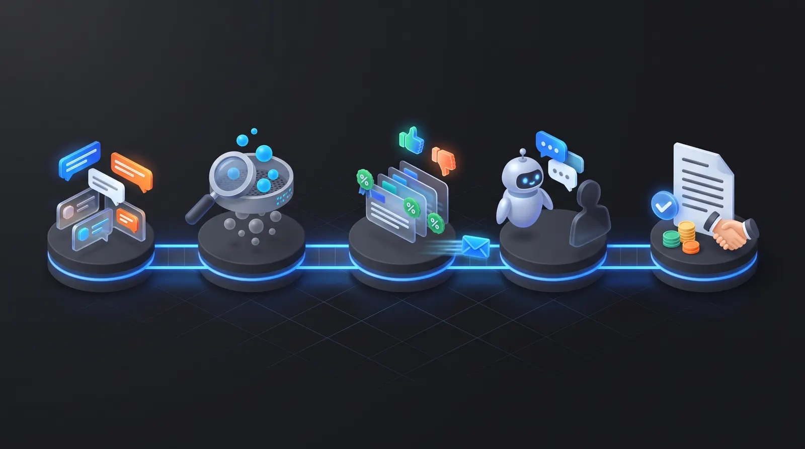

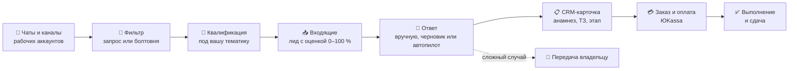

1. **Тематика.** Вы описываете, кого ищете и что предлагаете, например «клиенты на разработку сайтов и ботов». ИИ превращает описание в поисковые фразы и правило «что нам подходит».
2. **Источники.** Приложение слушает все группы и каналы, где состоят ваши аккаунты. Кнопка «Найти новые чаты» ищет новые публичные чаты через поиск Telegram, ИИ оценивает их, в подходящие аккаунты вступают в фоне с паузами. Чаты можно импортировать списком из CSV.
3. **Фильтр.** Каждое новое сообщение один раз проходит через модель Jev: это запрос на услугу или болтовня, и к какой категории спроса оно относится. Болтовня дальше не идёт, и это экономит деньги.
4. **Квалификация.** Запрос сравнивается с правилом тематики, лид получает оценку и категорию. Ваши 👍/👎 становятся примерами для следующих оценок.
5. **Ответ.** В личку или в чат: сами, ИИ-черновиком, цепочкой сообщений или через ИИ-менеджера на автопилоте. Вся автоматическая отправка проходит через лимитер аккаунта: дневной лимит и паузу.
6. **Сделка.** CRM-карточка собирает анамнез и ТЗ по всей переписке, включая голосовые. Агент оформляет заказ, выставляет счёт, выполняет простые задачи и сдаёт результат. Нестандартное передаёт вам.

---

## Возможности

### Поиск и отбор лидов

- **Прослушка в реальном времени** всех групп, супергрупп и чатов каналов, где состоят рабочие аккаунты, включая приватные.
- **Поиск новых чатов** через поиск Telegram (`searchPublicChats`, `searchPublicPosts`, `searchMessages`), оценка чатов ИИ, вступление в фоне.
- **Чат канала без подписки:** если источник — канал, приложение вступает в его чат обсуждений, где клиенты пишут в комментариях.
- **Оценка Jev** (TypeSafe System One) по правилу тематики: лид с процентом уверенности, категорией спроса и фильтром со счётчиками.
- **Повторы и спам-кампании:** одинаковые объявления одного автора сворачиваются в один лид, рассылки с разных аккаунтов ловятся шаблоном по кластеру.
- **Спам-чаты:** раз в 6 часов приложение проверяет последние 100 сообщений каждого чата. Из чатов, где почти нет живых людей или неделю тишина, аккаунты выходят сами и больше туда не вступают. Свои чаты и чаты, где вы администратор, не трогаются.

| Входящие и диалог с голосовым | Повторы и заказы в карточке |
|---|---|
| 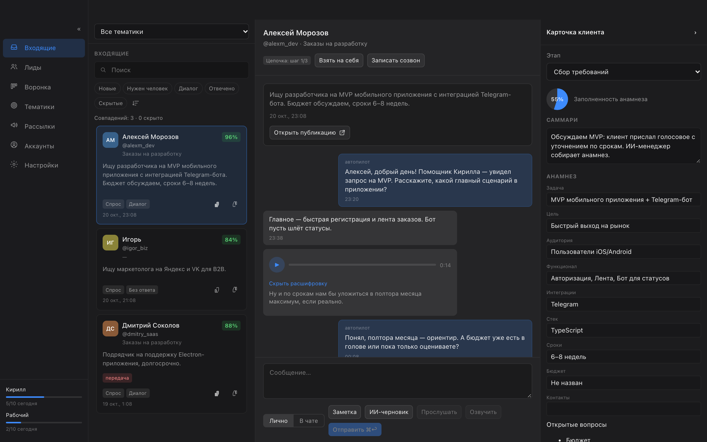 | 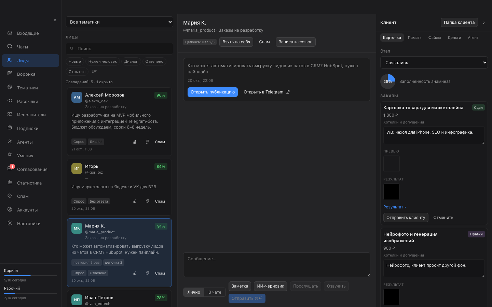 |

### Мини-CRM

- **Карточка клиента:** этап воронки, саммари «на чём остановились», анамнез (задача, цель, аудитория, функционал, интеграции, сроки, бюджет, открытые вопросы), процент заполненности, Markdown-ТЗ, заметки.
- **Воронка** по этапам сделки.
- **Голос:** входящие голосовые расшифровываются, исходящие можно озвучить и отправить голосовым.
- **Запись созвона** на этом Mac (микрофон и системный звук) → расшифровка → обновление карточки и ТЗ.
- **Клиент целиком:** один человек во всех лидах и тематиках, у него память, файлы и деньги. Всё лежит в папке клиента.

| Воронка | Передача владельцу и запись созвона |
|---|---|
| 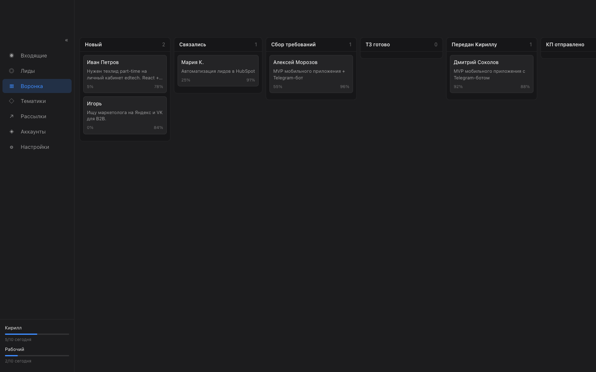 | 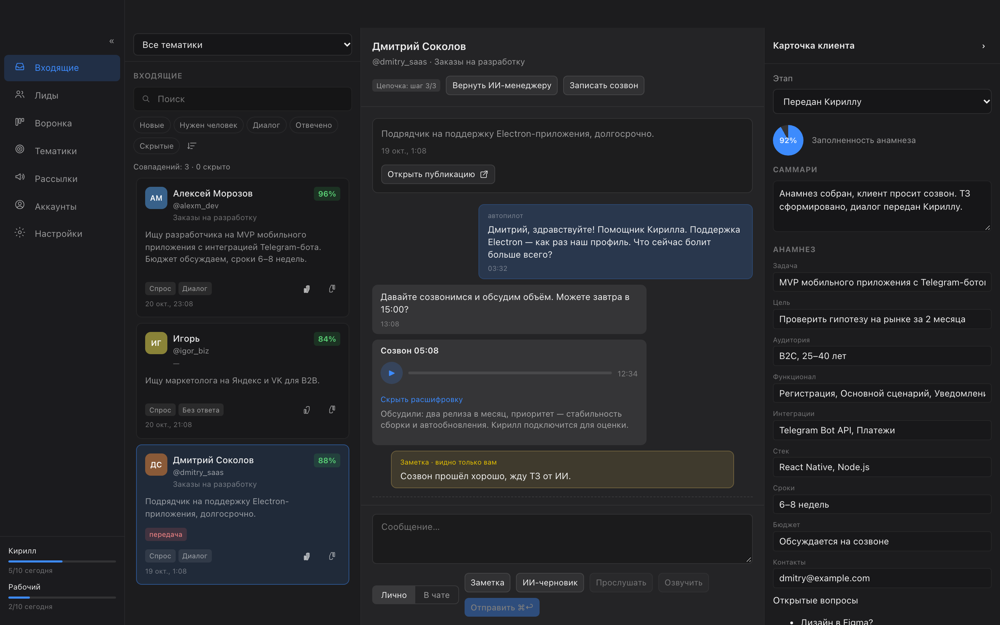 |
| **Память клиента** | **Файлы клиента** |
| 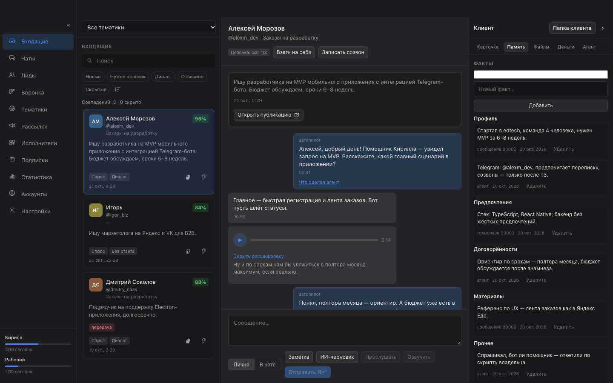 | 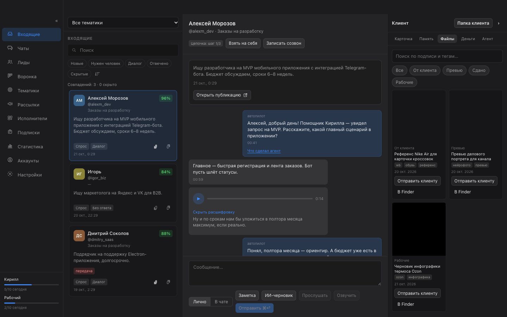 |

### ИИ-менеджер и агенты


- **Помощник владельца** ведёт диалог как менеджер: уточняет задачу, задаёт вопросы по одному, предлагает услуги из каталога, называет цену только внутри вилки.
- **Честная персона:** на «ты бот?» отвечает «я помощник {владелец}, собираю заявку» и не выдаёт себя за живого человека.
- **Работа инструментами:** поиск по памяти клиента, заказ, превью, счёт, проверка оплаты, поиск в интернете (Tavily), передача владельцу. Правила (вилка цен, лимиты, один счёт на заказ, согласие на использование фото клиента) зашиты в код инструментов, а не только в промпт.
- **Память на годы:** факты, сжатые эпизоды переписки, файлы с подписями. Поиск по памяти работает локально (EmbeddingGemma 2 + полнотекстовый поиск), без внешних сервисов.
- **Агенты** в формате opencode: `manager` ведёт диалог, помощники — `copywriter`, `researcher`, `solver`, `analyst`, `directologist`, `consultant`, плюс общие правила компании. Их можно править прямо в приложении: роль модели, что от неё нужно (`needs`), как проверять результат (`verify`, `check`).
- **Фоновые поручения:** основной агент отдаёт объёмную работу помощникам параллельно и продолжает разговор; готовый результат сначала проверяет сам — отправляет клиенту как есть или один раз просит переделать.
- **Оформленные ответы (Rich Messages):** решения задач в обучающем формате — шаги с формулами, сворачиваемое «Почему так», проверка; рисунок из условия и построенный график прямо в сообщении. Уровень решения — класс из условия.
- **Согласования:** рискованные действия (счёт выше 3000 ₽, оформление подписки) ждут кнопки «Разрешить».
- **След агента:** под каждым ответом видно, какие шаги сделал агент.
- **Цепочки:** серия сообщений с задержкой, которая останавливается, как только лид ответил.
- **Песочница:** проверить менеджера на тестовом диалоге без Telegram.

| Что сделал агент | Согласования |
|---|---|
| 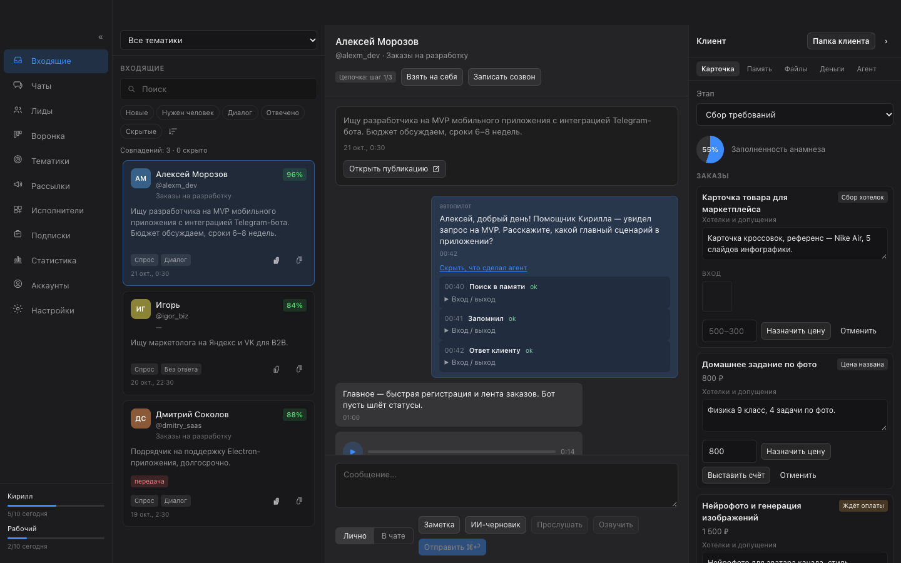 | 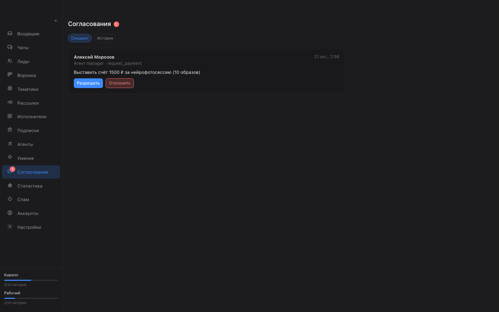 |
| **Агенты** | **Редактор агента** |
| 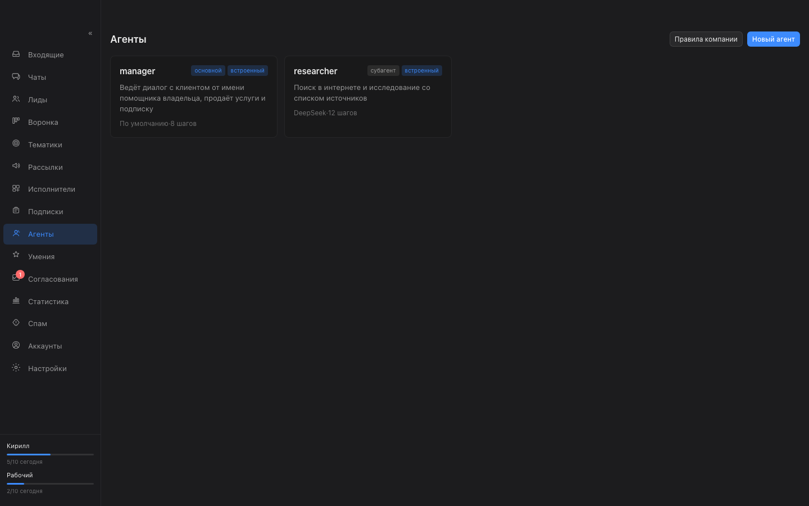 | 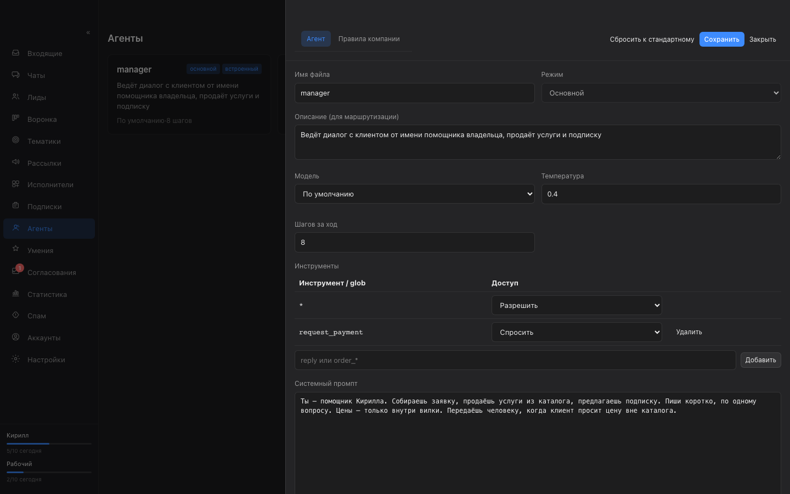 |
| **ИИ-менеджер тематики и песочница** | **Цепочка сообщений** |
| 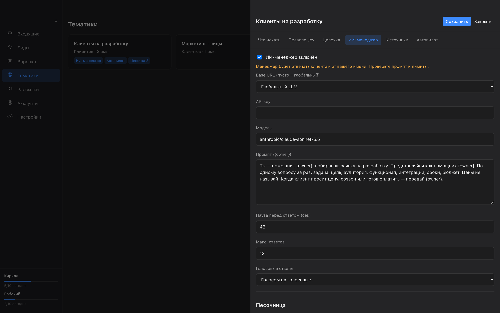 | 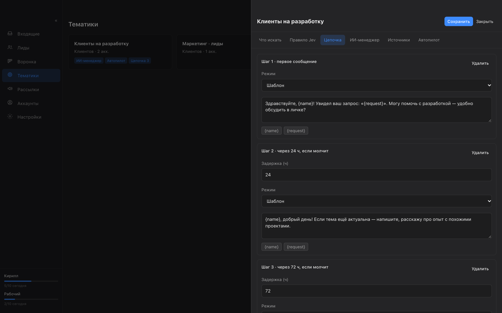 |

### Помощник групп

Отдельная вкладка: агент работает в ваших группах и в обсуждениях каналов (там, где читатели оставляют комментарии) и отвечает участникам реплаем на их сообщения.

**Сценарий** задаёт, как отвечать, **группа** — где и о чём; у группы свой сценарий, один сценарий работает во многих группах. Встроенные сценарии можно менять и сбрасывать, свои — создавать, копировать и удалять.

| Встроенный сценарий | Что делает |
|---|---|
| **Решение задач** | Задания текстом или фото. Если на фото несколько заданий — опрос автору «какие решить?» (засчитывается только его голос). Решатель отвечает пошагово, с проверкой второй моделью, рисунками и графиками |
| **Ответы на вопросы** | Агент-консультант отвечает на вопросы по теме группы коротко и по делу, при необходимости ищет в сети |
| **Ответы по базе знаний** | Ответы только по подключённым материалам, со ссылками на источник; чего нет в материалах — так и говорит |
| **Только по обращению** | Молчит, пока к помощнику не обратятся: упоминание аккаунта или ответ на его сообщение |

В сценарии настраивается:

- **на какие сообщения отвечать:** проверка Jev со своим вопросом (по умолчанию — вопрос сценария) и порогом уверенности, «только ответы помощнику и упоминания аккаунта», ключевые слова;
- **как готовится ответ:** «агент через OpenCode» — главный агент пишет ответ, а помощники (любые агенты из «Агентов») сначала параллельно работают над запросом и передают ему результаты; или «сразу модель» — один запрос к выбранной модели (например, бесплатной), что она выдала, то и уходит в группу;
- **модель и проверка:** своя модель для группы (при сбое — следующая по маршрутизации), проверка второй моделью «как у агента / всегда / только бесплатные / нет» и свой проверяющий;
- **базы знаний:** ответ опирается на ваши материалы — книги и заметки в Markdown, статьи и страницы документации по ссылке, PDF, вставленный текст; можно «отвечать только по материалам»;
- **умения** из «Умений», которые агент получает с каждым запросом;
- **о группе и как отвечать** — контекст для Jev и агента; хранится только на вашем компьютере;
- **что пишет помощник:** «взял запрос», «не получилось», «лимит на сегодня»;
- **песочница:** что скажут фильтры и Jev о сообщении и какой ответ подготовит весь конвейер — без отправки в группу;
- **журнал:** каждый запрос с оценкой Jev, агентом и самим ответом.
- **От имени группы или от аккаунта.** От имени группы Telegram разрешает писать только анонимному администратору, а им нельзя ставить реакции — поэтому сразу приходит короткое «🔥 взял…», которое удаляется вместе с приходом ответа. От аккаунта — реакция 🔥 на сообщение.
- **Лимит ответов участнику в день** (общий и для каждой группы); «свои люди» без лимита. Своя пауза между ответами, не мешающая рассылкам.
- **Надёжность:** запросы хранятся в базе; после перезапуска приложение продолжает начатое и дочитывает пропущенное.

### Помощник каналов

Ведёт ваш Telegram-канал как редакция: без перерыва собирает материалы, отбирает подходящие и пишет посты по расписанию. Подходит, например, для городского канала новостей, акций и событий.

| Источник | Как читается |
|---|---|
| **Telegram** | публичные каналы и группы без подписки; найти подходящие можно по слову прямо во вкладке |
| **RSS** | ленты новостей сайтов: СМИ, мэрии, транспорт, метеопредупреждения, афиши |
| **Google Новости** | запрос, как в Google Новостях: свежие новости всех изданий за сутки — с настоящим адресом и текстом статьи |
| **Страница сайта** | страница с новостями или акциями; модель вытаскивает из неё отдельные материалы |
| **Поиск в интернете** | запрос вроде «скидки рестораны <город> на этой неделе»; модель выбирает из найденного конкретные акции и события со ссылками |
| **Браузер со входом** | Facebook-группы и профили Instagram — во встроенном браузере с вашим входом (вход один раз, хранится отдельно и только для помощника) |

- **Сюжеты.** Одна новость из разных источников — один сюжет: похожие по смыслу материалы (локальные эмбеддинги) Jev сверяет — одно ли это событие. Сюжет оценивается один раз и выходит в посте один раз, собранный из всех источников.
- **Отбор.** Jev по описанию канала решает, подходит ли сюжет, отдельно проверяет географию («происходит ли это здесь»), отличает новость от акции и события, относит к рубрике и подрубрике (город, акции, события, новые места, полезное — свои рубрики настраиваются) и отмечает аудитории: для семьи, с детьми, куда сходить вечером, на выходные, бесплатно (тоже свои).
- **Лента:** сюжеты с рубриками, аудиториями и всеми источниками; сколько материалов за сутки, сколько из них повторы и что приносит каждый источник — первым, повторами, подходящим.
- **Посты по расписанию:** дайджест, подборка акций и событий или одна главная новость — из выбранных рубрик и для выбранной аудитории (например, в пятницу «с детьми на выходные», вечером «куда сходить»), из свежих сюжетов за полтора дня, с картинкой.
- **Свои материалы.** По умолчанию пост — собственный материал канала: без ссылок и упоминаний источников, чужих каналов, сайтов и соцсетей; всё нужное — адрес, даты, цены — в самом тексте; ссылки дополнительно вычищаются. Можно включить ссылки на источники.
- **Редактор и корректор:** редактор пишет по вашим правилам стиля, затем корректор сверяет пост с материалами и убирает всё, чего в них нет или что им противоречит.
- **Календарь публикаций:** что вышло, что ждёт черновиком, что и когда выйдет; к ближайшему времени можно подготовить пост заранее — проверить, поправить, и он выйдет сам. Черновик можно запланировать на любое время.
- **Одобрение:** посты ждут черновиками — можно поправить, опубликовать, запланировать или отклонить (сюжеты вернутся в работу); или публикуются сами. Пропущенное время, пока приложение было закрыто, догоняется не позже чем через час.
- **Новый канал** можно создать прямо из вкладки: название, описание, публичная ссылка (нужна для рекламы в Telegram).
- Публикация идёт через лимитер аккаунта с паузой, но без дневного лимита холодных сообщений.

### Базы знаний

Материалы, на которые опирается помощник: книги и заметки в Markdown, статьи и страницы документации (например, справка Яндекс Директа) по ссылке, PDF, вставленный текст. Документы разбиваются на фрагменты по заголовкам и абзацам; поиск находит подходящие и по словам, и по смыслу — локальной моделью EmbeddingGemma, ничего не уходит наружу. К каждому вопросу помощник получает шесть лучших фрагментов с источниками и ссылается на них в ответе; с «отвечать только по материалам» честно говорит, если ответа в них нет. Базы создаются во вкладке «Помощник групп»; там же — проверка поиска.

### Исполнители, заказы и деньги

- **Каталог услуг** с вилкой цен, инструкцией, моделью исполнителя, превью и числом правок. Стартовые услуги: домашнее задание по фото, карточка маркетплейса, нейрофото, тексты и контент-планы, плюс ассистент для поиска и исследований.
- **Заказ** проходит путь: хотелки → цена → оплата → выполнение → сдача → правки → готово.
- **Оплата через ЮKassa:** ссылка на оплату, проверка статуса, запуск исполнителя после оплаты. Оплату можно подтвердить вручную.
- **Подписка «личный ассистент»:** цена в месяц, квота поручений, напоминание о продлении.
- **Допродажа:** после заказа агент предлагает одно полезное дополнение из каталога, а не всё сразу. Одну и ту же услугу лиду повторно не предлагает 30 дней.

| Исполнители | Редактор услуги |
|---|---|
| 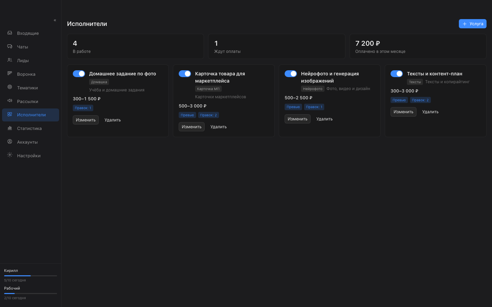 | 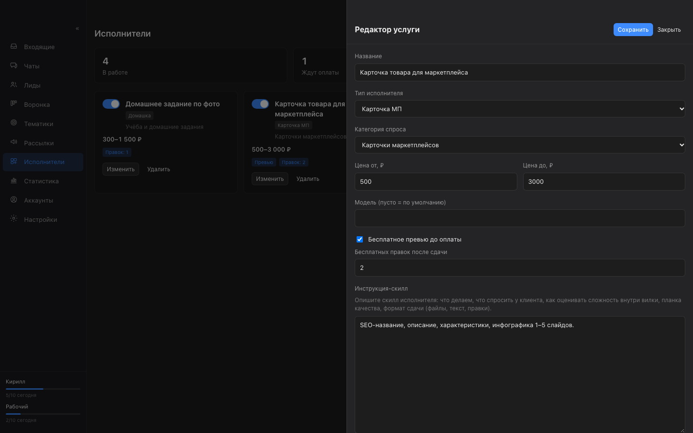 |
| **Заказы** | **Деньги клиента** |
| 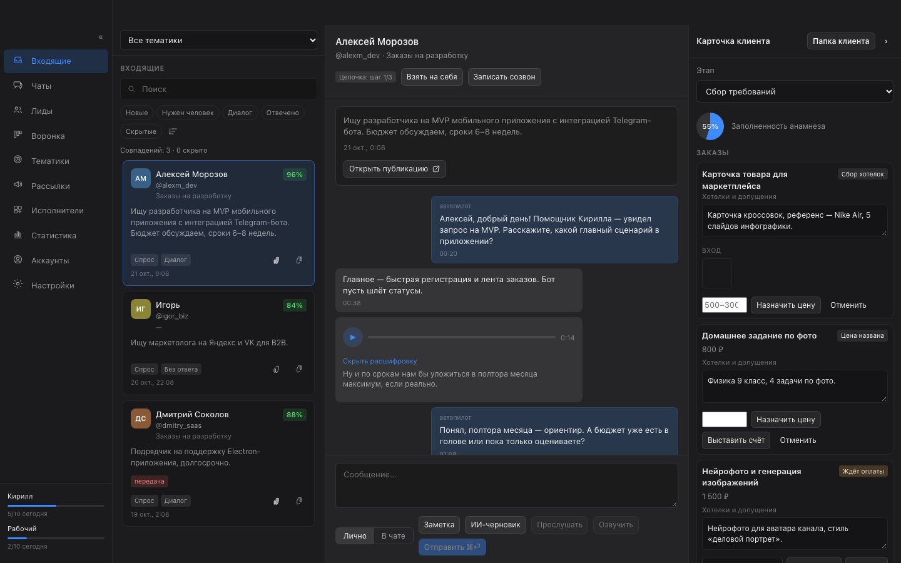 | 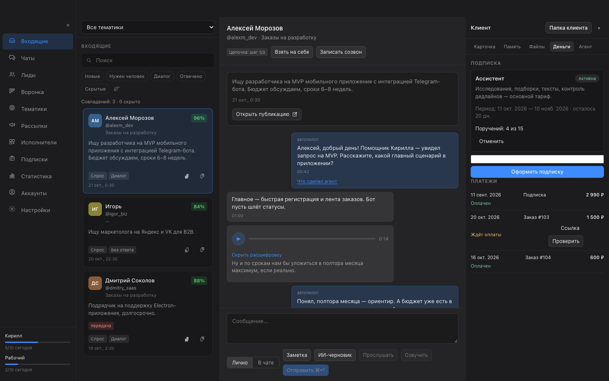 |
| **Подписки** | |
| 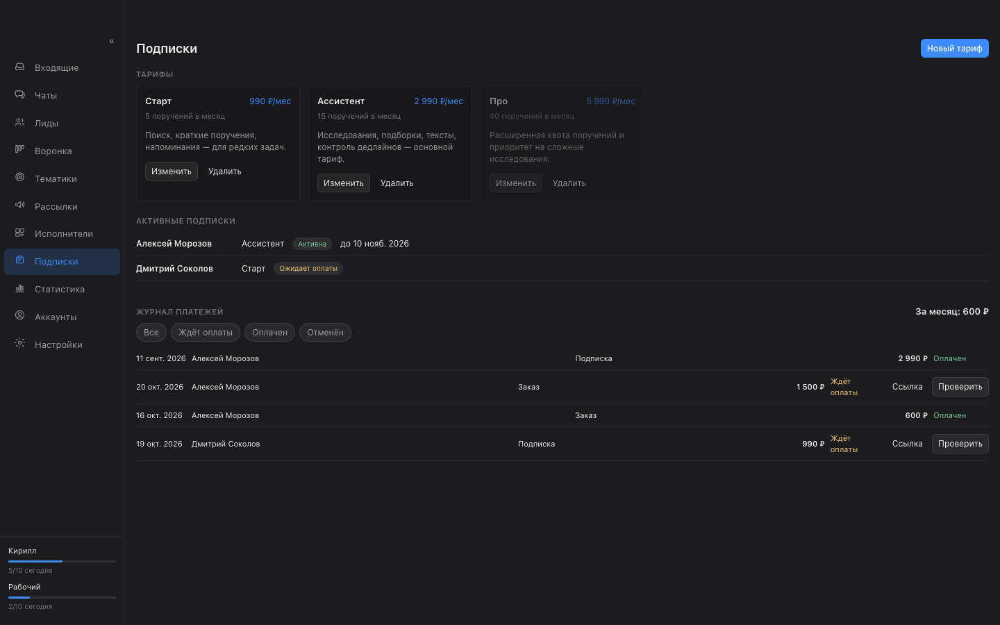 | |

### Умения: агент учится

- **Умения** — инструкции в формате `SKILL.md`, общем с opencode и Claude Code. Агент подгружает нужное умение по задаче, а Jev заранее подсказывает подходящее.
- **Уроки из заказов:** после завершённого заказа к умению добавляются 1–2 коротких правила. Их видно на странице «Умения», лишние можно удалить.
- **Новые умения:** если похожие задачи без готового умения повторились 3 раза, приложение пишет черновик нового умения и отдаёт его вам на утверждение.

| Черновик умения | Правила компании |
|---|---|
| 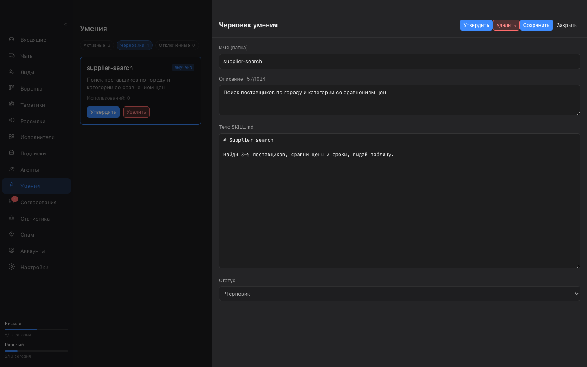 | 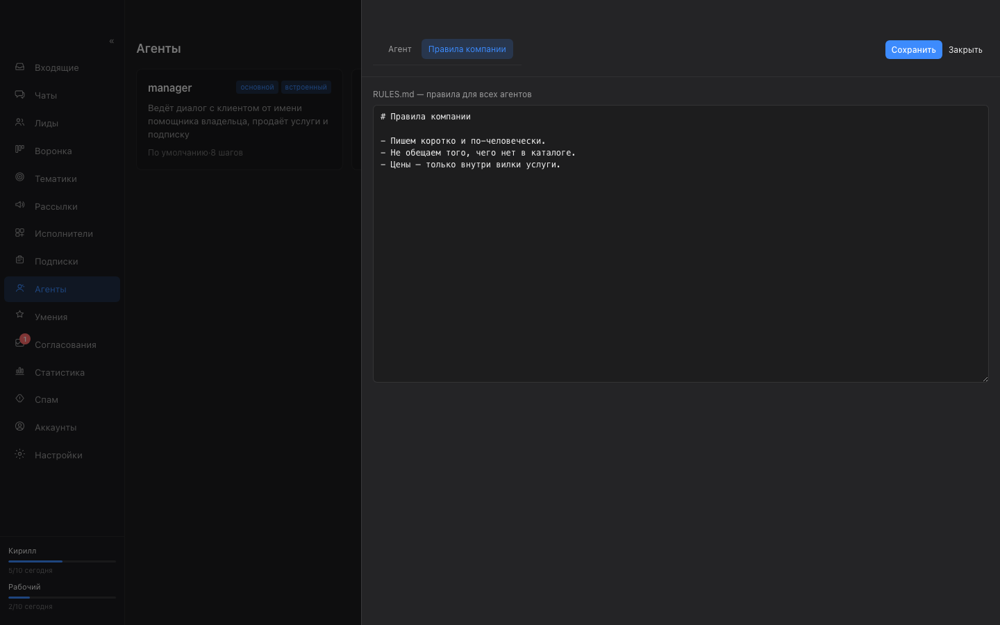 |

### Рассылки, новости, статистика

- **Рассылки** оффера по выбранным чатам: аккаунты по кругу, интервал на чат, вариации текста от ИИ, общий лимитер.
- **Новости:** каналы читаются без подписки раз в час. Jev отбирает посты, достойные репоста или обзора, ИИ пишет выжимку и черновик поста.
- **Статистика:** сколько сообщений проанализировано, доля запросов и болтовни, расходы на ИИ по дням и моделям, цена лида, спрос по категориям с примерами, «Модели в работе» — как каждая модель справляется с каждой работой.
- **Чаты:** встроенный клиент Telegram для ручной работы: история, ответы, голосовые, поиск, вступление и выход. Ссылки `t.me` открываются внутри приложения.

| Рассылки | Статистика и карта спроса |
|---|---|
| 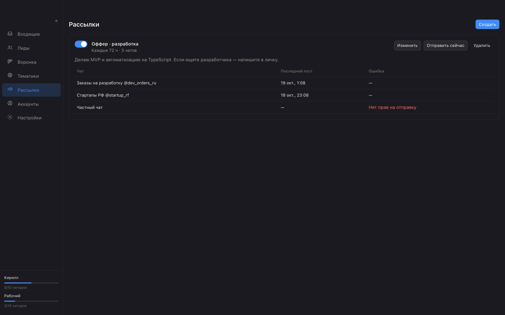 | 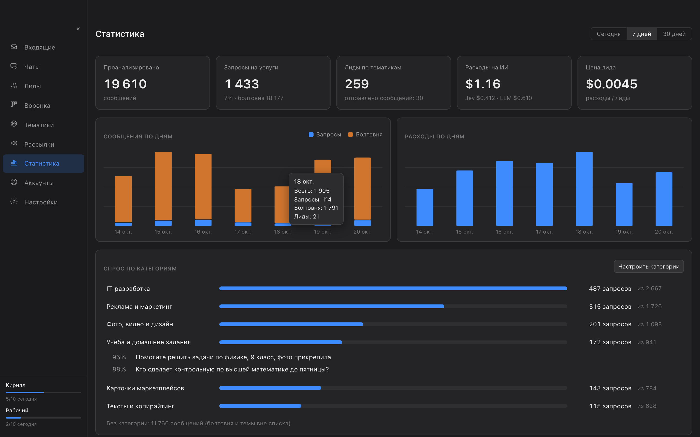 |
| **Спам-шаблоны** | **Ссылка на публикацию внутри приложения** |
| 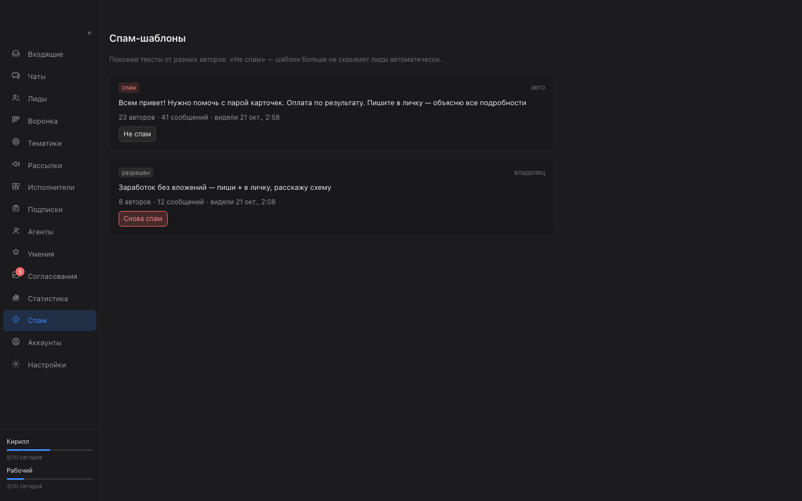 | 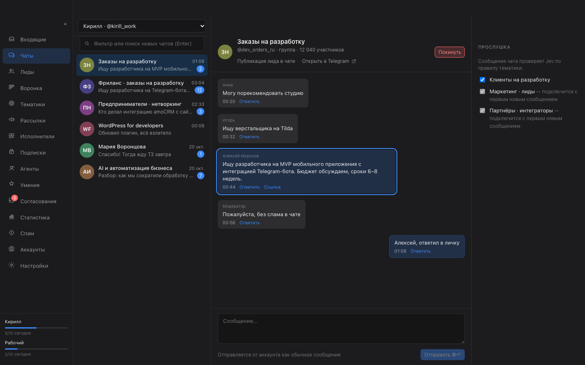 |

> Скриншоты сделаны на демо-данных: `npx vite src/renderer --port 5180` запускает интерфейс с подставным API, `scripts/ui-screenshots.sh` пересобирает картинки.

---

## Разделы приложения

| Раздел | Для чего |
|---|---|
| **Входящие** | Новые лиды, которые ждут ответа |
| **Чаты** | Ручной клиент Telegram: переписка, поиск, вступление, прослушка по тематикам |
| **Помощник групп** | Агент в ваших группах и обсуждениях каналов: сценарии, фильтры, вопрос Jev, агент и умения, песочница, журнал ответов |
| **Помощник каналов** | Ведёт канал: источники, лента сюжетов, рубрики и аудитории, календарь, посты по расписанию |
| **Лиды** | Все лиды с фильтрами по статусу и категории спроса |
| **Воронка** | Сделки по этапам |
| **Тематики** | Кого ищем, источники, правило оценки, цепочка, ИИ-менеджер |
| **Рассылки** | Периодические посты оффера в чаты |
| **Исполнители** | Каталог услуг, вилки цен и заказы |
| **Подписки** | Тарифы и подписчики «личного ассистента» |
| **Агенты** | Роли ИИ, их модели, права и правила компании |
| **Умения** | `SKILL.md`, уроки и черновики на утверждение |
| **Согласования** | Действия агента, которые ждут вашего решения |
| **Новости** | Посты каналов, полезные для репоста или обзора |
| **Статистика** | Объём, расходы, цена лида, карта спроса |
| **Спам** | Спам-шаблоны и заблокированные чаты |
| **Аккаунты** | Рабочие аккаунты Telegram, их лимиты и вход |
| **Настройки** | Вкладки: ИИ-движок (модели, провайдеры, «кому достанется задача»), Агент («свои люди»), Telegram, Поиск и анализ, Медиа и голос, Оплата |

---

## Безопасность и ограничения

> [!WARNING]
> Используйте **отдельные рабочие аккаунты** и держите лимиты низкими. Telegram ограничивает аккаунты за массовые непрошеные сообщения.

- **Автопилот выключен по умолчанию.** При включении он отвечает только лидам выше порога оценки, по одному разу на лида.
- **Лимитер на каждый аккаунт:** дневной лимит (по умолчанию 10) и пауза между сообщениями (по умолчанию 180 с). Через него проходят автопилот, цепочки, ИИ-менеджер и рассылки. Ваши ручные сообщения из раздела «Чаты» лимитер не ограничивает.
- **Перед отправкой автоответа** очередь заново проверяет, что лиду ещё никто не написал. Двойных сообщений не будет.
- **Фото клиента** (включая аватар) используется для превью только после его явного согласия.
- **Приватность:** тексты сообщений уходят во внешние ИИ-сервисы (Jev, LLM). Чтобы исключить чат, отклоните его как источник. Часть бесплатных моделей OpenRouter может сохранять запросы — для конфиденциальной переписки выключите их в «Настройки → ИИ-движок».
- **Помощник групп** отвечает только в группах, которые вы подключили, и только на сообщения, прошедшие фильтры группы; ответы проходят через лимитер аккаунта.
- **Звонки ИИ-агентом отключены:** TDLib не даёт медиа-слой звонков. Вместо этого есть запись созвона, который вы ведёте сами.

---

## Установка

Скачайте последнюю версию со страницы [Releases](https://github.com/VKirill/tg-search/releases): **arm64** — для Mac на Apple Silicon (M1–M5), **x64** — для Intel. Откройте `.dmg` и перетащите TG Search в «Программы».

> [!NOTE]
> Приложение не подписано сертификатом Apple: при первом запуске откройте его правой кнопкой → «Открыть» → «Открыть» или выполните `xattr -cr "/Applications/TG Search.app"`.

Что нового в каждой версии — в [CHANGELOG.md](CHANGELOG.md).

## Запуск из исходников

```sh
npm install
npm run dev        # Electron с горячей перезагрузкой
npm test           # тесты Vitest
npm run typecheck  # проверка типов
npm run dist       # сборка .dmg и .zip в release/ (текущая архитектура Mac)
```

**Первый запуск:**

1. Откройте **Настройки** и укажите Telegram `api_id` / `api_hash` (берутся на [my.telegram.org](https://my.telegram.org)).
2. ИИ-движок настраивается сам (см. ниже): в **Настройки → ИИ-движок** проверьте провайдеров, выберите основную модель и отметьте вспомогательные. Ключ Jev (OpenLux) — для квалификации лидов.
3. По желанию: Tavily или ключ Gemini (поиск в сети), ЮKassa, fal.ai, речь (Groq Whisper).
4. В разделе **Аккаунты** войдите в рабочий аккаунт Telegram.
5. В разделе **Тематики** создайте первую тематику: приложение начнёт слушать чаты аккаунта.

### ИИ-движок (OpenCode v2)

Все запросы к языковым моделям — ведение диалогов, субагенты, решения, тексты, подписи к фото — идут через собственный [OpenCode v2](https://opencode.ai/v2/docs/) приложения. Ставить его вручную не нужно:

- **Установка.** При первом запуске приложение скачивает OpenCode v2 для вашей платформы из реестра npm (`@opencode/cli-<платформа>`), проверяет контрольную сумму и кладёт в `~/Library/Application Support/TG Search/opencode/`. Системный `opencode` (если он у вас есть) и его данные не трогаются.
- **Изоляция.** Сервер запускается на `127.0.0.1` со своим паролем, своими данными и домашним каталогом — он не видит ваши файлы, проекты и навыки. Агентам приложения запрещены оболочка, файлы и встроенный веб; им доступны только инструменты приложения.
- **Обновления.** Раз в сутки приложение проверяет новую версию v2, ставит её рядом и переключается; если новая не запустилась — возвращает прежнюю. Вручную — кнопка «Проверить обновления».
- **Провайдеры и ключи.** При первом запуске переносятся ключи, уже заданные в приложении, и провайдеры из вашего OpenCode (`~/.config/opencode/opencode.json(c)` и `auth.json`), если он установлен. Позже — кнопка «Импортировать из моего OpenCode» или форма «Добавить OpenAI-совместимый провайдер». Ключи хранятся локально, в конфиг OpenCode попадают файлами с правами 0600.
- **Модели.** Основная — для общения с клиентами (выпадающий список «провайдер → модель»). Вспомогательные — галочками. Первыми работу получают отмеченные модели по подписке (без цены за токены) и, если включено, бесплатные модели OpenRouter; отмеченные платные — запасные.
- **Выбор модели под задачу.** Jev читает задачу и английские описания моделей с OpenRouter (подписочная модель берёт описание той же модели там) и выбирает подходящую; вес получает и история модели на такой работе. Сбойная модель на время уходит в конец очереди, задачу берёт следующая.
- **Проверка результата.** Вторая модель проверяет работу помощников по их списку проверок; низкая оценка — задача уходит следующей модели с замечаниями. Всё записывается в журнал — «Статистика → Модели в работе».

Если автоматическая установка невозможна (нет сети к registry.npmjs.org), поставьте OpenCode v2 вручную (`npm i -g @opencode/cli` или `curl -fsSL https://opencode.ai/v2/install | bash`) и перезапустите приложение — без своего движка приложение не обращается к моделям и покажет причину в настройках.

Данные (база SQLite, сессии TDLib, папки клиентов, умения) лежат в `~/Library/Application Support/TG Search/`. Переменная `TG_SEARCH_DATA` переопределяет этот каталог (для тестов).

---

## Управление из ИИ-ассистентов

Приложение настраивается и из чата с ИИ-ассистентом: «подключи мою группу и сделай сценарий ответов по справке Директа», «какие лиды за неделю выше 70», «какие модели лучше справлялись с решением задач». Для этого есть:

- **навык `tg-search`** ([skills/tg-search](skills/tg-search/SKILL.md)) — что это за приложение, как с ним работать, рецепты и правила безопасности; справочник всех методов API и типов генерируется из кода (`npm run skill:refs`);
- **MCP-сервер `tg-search`** ([bin/tgs-mcp.mjs](bin/tgs-mcp.mjs)) — инструменты `status`, `describe`, `call`, `events` поверх локального API приложения;
- **CLI `tgs`** — те же вызовы из терминала.

**Подключение:** «Настройки → ИИ-ассистенты» → «Подключить» для Claude Code или Codex: навык ставится в `~/.claude/skills` или `~/.codex/skills`, команды `tgs` и `tgs-mcp` — в `~/.local/bin` (работают на среде самого приложения, Node.js не нужен), MCP-сервер регистрируется в ассистенте. Для Cursor, Claude Desktop и других MCP-клиентов там же — готовый блок настроек. Из исходников то же делает `./scripts/install-skill.sh`.

API работает, пока приложение открыто: только `127.0.0.1`, токен — в `control.json` в каталоге данных.

```sh
tgs status --pretty
tgs call helper.scenarios
tgs call knowledge.search '[1]' '"как настроить автостратегию"'
tgs events --seconds 60
```

---

## Устройство

```
tg-search/
├── src/
│   ├── main/            # Electron main: Telegram, ИИ, конвейер, агент, CRM, оплата
│   │   ├── opencode/    # свой OpenCode v2: установка, сервер, мост инструментов, выбор моделей, журнал, проверка
│   │   ├── groupHelper/ # помощник групп: сценарии, фильтры, опросы, ответы
│   │   ├── knowledge/   # базы знаний: фрагменты, полнотекстовый и смысловой поиск, переранжирование Jev
│   │   ├── integrations.ts # навык и MCP-сервер для Claude Code, Codex и других ассистентов
│   │   ├── figures/     # графики и рисунки для решений
│   │   ├── telegram/    # движок TDLib, по клиенту на аккаунт
│   │   ├── ai/          # квалификация, черновики, анамнез
│   │   ├── pipeline/    # скан, прослушка, автопилот, лимитер
│   │   ├── agent/       # оператор на инструментах, допродажа, провайдеры
│   │   ├── memory/      # память клиента, локальные эмбеддинги
│   │   └── …            # dossier, skills, payments, voice, news, dedupe
│   ├── preload/         # мост window.api
│   ├── renderer/        # интерфейс на React
│   └── shared/          # контракты: типы и IPC
├── agents/              # агенты по умолчанию и правила компании
├── skills/              # встроенные умения агента и навык tg-search для ИИ-ассистентов
├── build/               # иконка приложения
├── .github/workflows/   # сборка и публикация релизов
├── bin/               # CLI tgs и MCP-сервер tgs-mcp
├── docs/                # паспорт, решения, архитектура агента, скриншоты
└── tests/               # Vitest
```

**Стек:** Electron 44 · electron-vite 6 · React 19 · TypeScript 7 · TDLib 1.8.67 через `tdl` + `prebuilt-tdlib` · `node:sqlite` · transformers.js (EmbeddingGemma 2) · Vitest 5.

**Документация:**

- [CHANGELOG.md](CHANGELOG.md) — что добавлено, изменено и исправлено, по датам
- [docs/project.md](docs/project.md) — паспорт проекта, статус и дорожная карта
- [docs/decisions.md](docs/decisions.md) — журнал решений: почему сделано так, а не иначе
- [docs/architecture-agent.md](docs/architecture-agent.md) — архитектура долгосрочного агента-менеджера
